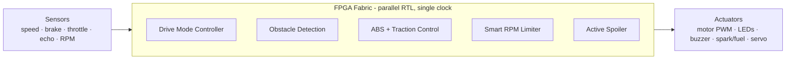

[](https://en.wikipedia.org/wiki/Verilog)
[]()
[]()
[]()

# 🚗 FPGA-Based Advanced Automotive ECU Suite

A collection of synthesizable, hardware-level automotive control modules designed in **Verilog/SystemVerilog** for FPGA deployment. The suite implements safety-critical vehicle dynamics, engine protection, active aerodynamics, driver assistance and drive-feel logic, each with its own self-checking testbench.

> Developed as an **NTI Project Recognition** submission (*Digital Design using FPGA*), October 2026.

Detailed design calculations, block diagrams and state machine specifications are documented in [`docs/project_report.pdf`](docs/project_report.pdf).

---

## 📑 Table of Contents

1. [Motivation](#-motivation)
2. [The Problem with Sequential MCUs](#-the-problem-with-sequential-mcus)
3. [Our Solution](#-our-solution-one-dedicated-hardware-ecu-per-job)
4. [Top-Level Architecture](#-top-level-architecture)
5. [ECU Subsystems in Detail](#-ecu-subsystems-in-detail)
6. [Results & Verification](#-results--verification)
7. [Why FPGA (and the ASIC Path)](#-why-fpga--and-the-asic-path)
8. [Target Users & Impact](#-target-users--impact)
9. [Folder Layout](#-folder-layout)
10. [Tools & Simulation](#-tools--simulation)
11. [Roadmap](#-roadmap)
12. [Team & Acknowledgements](#-team--acknowledgements)

---

## 💡 Motivation

A modern car runs **50–100 ECUs**, from the A/C to the brakes. Economy-class ECUs usually share a sequential CPU, and that lag is something the driver can actually feel in the response of the car.

We love car mechanics and vehicle dynamics, so we asked a simple question:

> **What if every ECU was dedicated hardware?**

The idea became *Physics → Verilog → FPGA*: turning real car behavior into synthesizable RTL. We picked **five real problems**: **Braking, Revs, Aero, Parking and Pedal Feel**. For each one we built a dedicated ECU that **senses, decides and acts in hardware**. The goal was to prove each design in simulation and keep it ready for silicon.

---

## ⚠️ The Problem with Sequential MCUs

A shared CPU runs everything in turn: `task 1 → task 2 → …`, one at a time, plus interrupts and OS jitter. That is acceptable for comfort functions (A/C, dashboard) but risky for safety functions:

| Failure | Consequence |
|---|---|
| Late ABS reaction | Wheels lock, longer stopping distance |
| Missed rev-limit | Engine damage over time |
| Sluggish throttle | Dead or jumpy pedal feel |
| One crash hangs everything | Single point of failure |

Sequential tasks pile up (`1 CPU → N tasks`), which causes queuing delay and **jitter**: the response time varies from run to run.

---

## ✅ Our Solution: One Dedicated Hardware ECU per Job

Instead of one CPU, each function is an **independent circuit** written in Verilog. All five run **at the same instant**: `BRAKE || SPOILER || RPM || PARKING || DRIVE`.

**Design rules**

- **Synchronous RTL:** one clock, clean resets.
- **Modular ECUs:** each module senses, decides and acts.
- **Synthesizable:** no simulation-only tricks.
- **Self-tested:** every ECU has a testbench that proves it.

**What this gives us**

- **True parallelism:** 5 ECUs, zero waiting.
- **Determinism:** same input, same cycle, same output.
- **Isolation:** one faulty block cannot hang the others.

---

## 🧩 Top-Level Architecture



Shared signals across the suite: **vehicle speed, brake pedal, throttle and PWM**.

### I/O summary

| ECU | Inputs | Outputs |
|---|---|---|
| **ABS + Traction Control** | front/rear wheel speed (8-bit), `brake_pedal`, `ecu_pwm` | `final_pwm`, `abs_brake_pulse`, TCS/ABS LEDs |
| **Smart RPM Limiter** | `engine_rpm`, `vehicle_speed`, `brake_pedal`, `throttle_in` | `spark_retard`, `fuel_cut` |
| **Active Spoiler** | `vehicle_speed` (9-bit), `brake_pedal` | `spoiler_pwm` (servo), `airbrake_led` |
| **Obstacle Detection** | `echo_pulse` (ultrasonic sensor) | `led_green`, `led_yellow`, `led_red`, `buzzer_out` |
| **Drive Mode Controller** | `throttle_in` (2-bit), `drive_mode` (2-bit) | `motor_pwm` (8-bit) |

---

## 🔧 ECU Subsystems in Detail

### 1. 🛑 ABS + Traction Control (Module 1/5)

**Idea**

1. Compares **front vs rear wheel speed on every clock**.
2. **Braking + slip > 15** → generates an **ABS pulse** so the wheel never locks. The ECU modulates pressure in the cycle *increase → hold → decrease*.
3. **Driving + wheel spin** → the torque PWM is **halved** (traction control, TCS).

| | |
|---|---|
| **Inputs** | front/rear speed (8-bit), `brake_pedal`, `ecu_pwm` |
| **Outputs** | `final_pwm`, `abs_brake_pulse`, TCS LED, ABS LED |
| **Testbench** | `tb_Traction_ABS` |

**Verification:** lock-up braking, launch wheel-spin and normal cruising stimuli. Pulses, torque halving and LED states are checked on the waveforms.

---

### 2. 🛡️ Smart RPM Limiter (Module 2/5)

A three-stage engine protection scheme:

| Stage | RPM | Action |
|---|---|---|
| **Launch control** | ~4k (with speed 0 + brake + full throttle) | Holds revs via **spark retard** |
| **Soft cut** | 9k | **Retards spark** (warning zone) |
| **Hard cut** | 10k | **Cuts fuel** (danger zone) |

Spark retard acts on the **power stroke** and fuel cut acts on the **intake**, so the redline is never crossed.

| | |
|---|---|
| **Inputs** | `engine_rpm`, `vehicle_speed`, `brake_pedal`, `throttle_in` |
| **Outputs** | `spark_retard`, `fuel_cut` |
| **Testbench** | `tb_Smart_RPM` |

**Verification:** a full RPM sweep from 0 to 10k, plus the launch combo. The cuts fire at the exact thresholds.

---

### 3. 🏎️ Active Spoiler System (Module 3/5)

**Idea**

1. **Speed stages:** `< 80 km/h` closed, `80–150 km/h` cruise angle, `> 150 km/h` track (max downforce).
2. **Braking at speed** → full **air-brake** (PWM = 255) and the `airbrake_led` lights up.
3. **Smooth servo motion:** the output moves in **±1 steps**, so there are no jerks.

| | |
|---|---|
| **Inputs** | `vehicle_speed` (9-bit), `brake_pedal` |
| **Outputs** | `spoiler_pwm` (servo), `airbrake_led` |
| **Testbench** | `tb_Active_Spoiler` |

**Verification:** a speed ramp through all stages, then a sudden brake stab at speed. The angles track their targets and the air-brake fires.

---

### 4. 🅿️ Obstacle Detection / Ultrasonic Parking Assist (Module 4/5)

**Idea**

1. **Always-on** ultrasonic echo timing (not only in reverse).
2. A counter measures the echo time, which gives the distance, and maps it to **zones**: Safe / Mid / Close / Danger.
3. **Alerts escalate:** LEDs change color and the buzzer goes from slow beeps to continuous.

How it measures: the counter **starts**, the echo **returns**, the counter **stops**, and the count is the distance.

| | |
|---|---|
| **Inputs** | `echo_pulse` (ultrasonic sensor) |
| **Outputs** | `led_green`, `led_yellow`, `led_red`, `buzzer_out` |
| **Testbench** | `tb_parking_system` |

**Verification:** short and long echo pulses. Each one must produce the correct zone, LED state and beep rate.

---

### 5. ⚙️ Multi-Mode Drive Controller (Module 5/5)

**Idea**

1. **A lookup table (LUT) per mode** maps throttle to target duty cycle: **Eco** (calm) → **Normal** → **Sport** → **Track** (aggressive).
2. A **slew-rate limiter (±1 step)** prevents abrupt power spikes and protects the drivetrain from shock.
3. An **8-bit PWM** drives the motor smoothly.

The real-hardware demo uses a physical mode dial to switch from Eco to Track.

| | |
|---|---|
| **Inputs** | `throttle_in` (2-bit), `drive_mode` (2-bit) |
| **Outputs** | `motor_pwm` (8-bit) |
| **Testbench** | `tb_Drive_Mode` |

**Verification:** all 4 modes × all throttle steps. The curves match the LUT and the ramp climbs smoothly with no jumps. The duty-cycle output can also be exposed directly to traction control for torque-management integration.

---

## 📊 Results & Verification

| | **Before (MCU)** | **After (FPGA ECUs)** |
|---|---|---|
| Execution | Sequential, systems wait in line | All 5 in parallel, react in the same clock cycle |
| Timing | Jittered, varies run to run | Deterministic, identical every run |
| Fault tolerance | One CPU, single point of failure | Isolated ECUs, one fault cannot hang the others |

**Quality metrics**

- ✅ **5/5 testbenches pass**
- ✅ **Zero latches**, synchronous resets
- ✅ **100% synthesizable RTL**
- ✅ Documented in [`docs/`](docs/)

---

## 🔬 Why FPGA (and the ASIC Path)

- **Parallelism:** 5 real circuits at once, with no scheduler and no waiting.
- **Determinism:** cycle-exact timing that is provable, testable and certifiable.
- **Reliability:** no OS and no crashes, plus power-efficient logic.
- **FPGA → ASIC:** low volume → FPGA wins. High volume → the **same RTL** can be taped out to an ASIC. The code is ready for both.

---

## 🎯 Target Users & Impact

**Who can use it**

- **Motorsport teams (GT / Formula):** every millisecond is lap time.
- **Supercar makers:** low volume, extreme demands.
- **EV startups:** fast iteration on FPGA platforms.
- **Track aftermarket:** retrofit kits for enthusiasts.

**Impact**

- **Safety:** shorter stops and protected engines.
- **Performance:** sharper response and faster laps.
- **Platform:** proven RTL blocks that are reusable in ADAS/EV projects.

---

## 📂 Folder Layout

* **[`rtl/`](rtl/)**: Synthesizable Verilog/SystemVerilog modules for the individual automotive control units.
* **[`tb/`](tb/)**: Independent, self-checking testbenches with targeted stimulus injection for each subsystem.
* **[`docs/`](docs/)**: Technical report ([`project_report.pdf`](docs/project_report.pdf)) with hardware specs and simulation analysis.

---

## 🛠️ Tools & Simulation

* **Language:** Verilog / SystemVerilog
* **Design methodology:** synthesizable RTL, synchronous FSM design
* **Simulation & EDA tools:** ModelSim / Questasim / Vivado / Icarus Verilog & GTKWave

### Running an Individual Subsystem Simulation (Icarus Verilog)

Any module can be simulated standalone, in seconds, together with its matching testbench:

```bash
# Example: ABS & Traction Control
iverilog -o abs_sim tb/tb_Traction_ABS.v rtl/<abs_traction_module>.v
vvp abs_sim

# View the waveform
gtkwave abs_sim.vcd
```

The same flow works for the other subsystems. Replace the files with the matching pair:

| Subsystem | Testbench |
|---|---|
| ABS + Traction Control | `tb_Traction_ABS` |
| Smart RPM Limiter | `tb_Smart_RPM` |
| Active Spoiler | `tb_Active_Spoiler` |
| Obstacle Detection | `tb_parking_system` |
| Drive Mode Controller | `tb_Drive_Mode` |

### What to look for in the waveforms

- **RPM sweep 0 → 10k:** cuts fire at the 4k / 9k / 10k thresholds.
- **Obstacle echoes:** zones and beep rate change as the echo length changes.
- **ABS slip:** torque halves the instant slip trips.

The same flow works on Questasim and Vivado.

---

## 🗺️ Roadmap

1. **Top-level ECU:** integrate all 5 modules with arbiter logic.
2. **FPGA bring-up:** Artix-7 / Zynq with timing constraints.
3. **CAN-bus link:** talk to the real car network.
4. **HIL testing:** hardware-in-the-loop with real sensors and actuators on the bench.

---

## 👥 Team & Acknowledgements

**Supervised by**
Eng. Mohammed Salah Aboshosha · Eng. Omar Mostafa Aladawy

**Project team**
Amr Waheed Mohammed · Aly Hamdy Aly · Abdelrahman Youssef · Zeyad Khaled Abd Elhamid · Adham Amr Mohammed

We thank our supervisors for their support and guidance.

Repository: [github.com/alyhamdy879/automotive-ecu-fpga-main](https://github.com/alyhamdy879/automotive-ecu-fpga-main)
